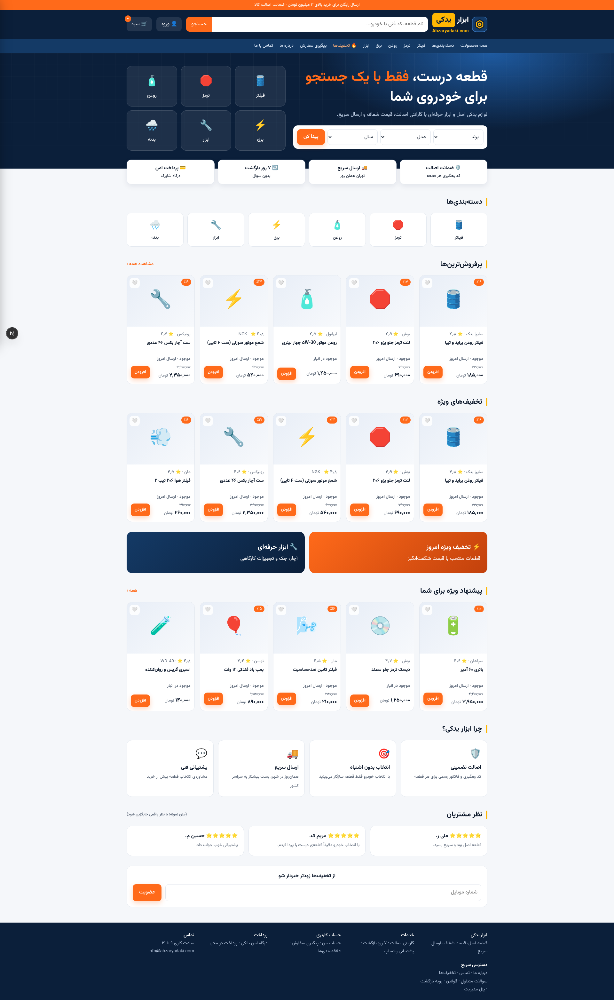
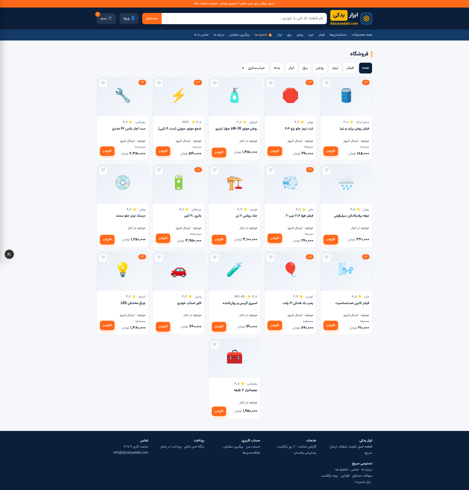
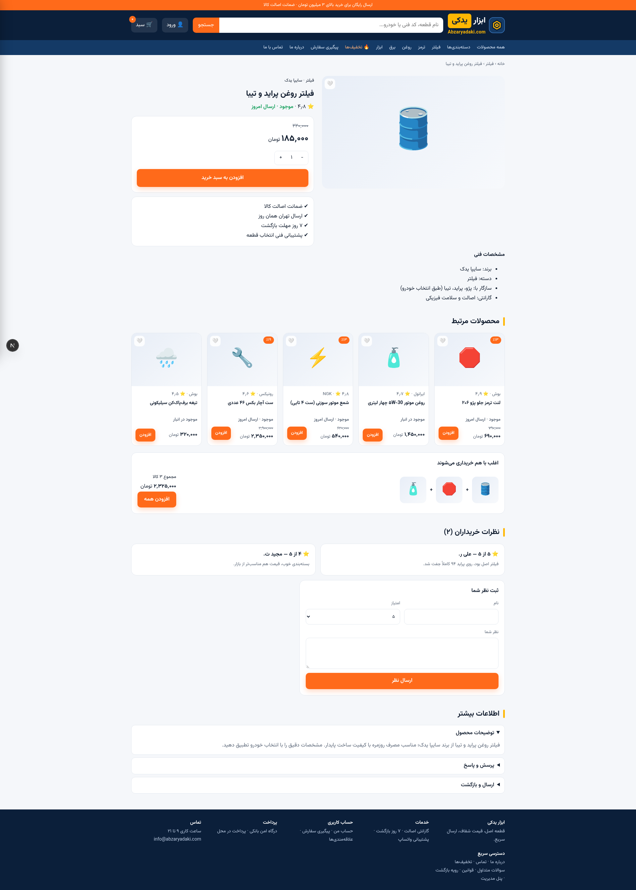
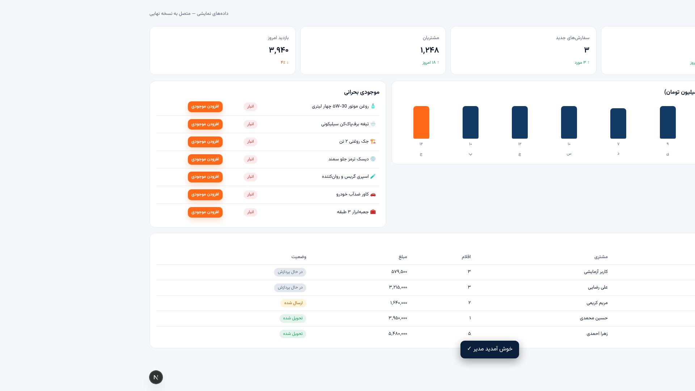
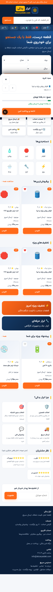
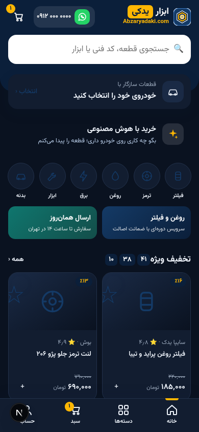

<div align="center">

[فارسی](README.md) · [English](README.en.md)


# Abzar Yadaki — Persian (Farsi) Auto Parts & Tools E-Commerce Template

**A complete, production-running online store for auto parts and tools — right-to-left (RTL) Persian UI, full admin dashboard, and a built-in mobile app — built with Next.js 16, TypeScript, Tailwind CSS 4 and Supabase.**

[](https://nextjs.org)
[](https://www.typescriptlang.org)
[](https://tailwindcss.com)
[](https://supabase.com)
[](https://github.com/pmndrs/zustand)
[](https://ui.shadcn.com)
[](https://vercel.com)
[](#)

**🌐 Live store: [abzaryadaki.com](https://www.abzaryadaki.com)** — this repository powers a real, running e-commerce website and doubles as a **ready-made template for building your own Persian online store**.

*قالب فروشگاه اینترنتی فارسی — فروشگاه ابزار و لوازم یدکی خودرو با پنل مدیریت کامل*

</div>

---

## 📸 Screenshots

| Home | Shop |
|---|---|
|  |  |
| **Product page** | **Admin dashboard** |
|  |  |
| **Built-in mobile app** | **Mobile dark mode** |
|  |  |

## 📖 About This Project

**Abzar Yadaki** (ابزار یدکی, meaning "Spare Tools/Parts") is a full-featured Persian e-commerce website selling hand tools, power tools and automotive spare parts. It is both a **real production storefront** (live at [abzaryadaki.com](https://www.abzaryadaki.com)) and an **open starting point for developers who want to launch a Persian / Farsi online shop** with a modern stack.

**Why use this as your next e-commerce template?**

- 🇮🇷 **First-class Persian (Farsi) RTL experience** — not an afterthought: Vazirmatn font, Persian numerals and prices (Toman), RTL layout designed for Persian shoppers
- 🔍 **Smart Persian search normalization** — Latin "206" matches «۲۰۶», Arabic «ي/ك» matches «ی/ک», half-space and spacing differences handled automatically
- 🧩 **Modern 2025 stack**: Next.js 16 App Router, strict TypeScript, Tailwind CSS 4, shadcn/ui, Zustand
- 🗄️ **Ready backend with Supabase**: PostgreSQL schema + 4 migrations, row-level security (RLS), realtime updates, phone OTP authentication
- 🛠️ **Full admin panel (10 sections)** embedded in the same website — no separate CMS project needed
- 📱 **Built-in mobile app experience**: an auto-switching mobile UI (`#app` routes) served by the same codebase
- 🚀 **One-click deploy on Vercel** — the live site deploys automatically from this repository
- 🛡️ **Security-minded**: rate limiting on public APIs, server-side price & coupon validation, RLS policies

## ✨ Storefront Features

- 🏠 **Home page**: manageable banners, category grid, flash deals, best sellers
- 🛍️ **Shop & live search**: instant search across product names and brands with Persian text normalization, category/brand filters, price sorting
- 📦 **Product page**: specs, ratings, reviews, gallery, add-to-cart / wishlist / waiting list
- 🛒 **Persistent cart**: survives browser restarts (Zustand persist) + cart drawer + mobile buy bar
- ⏳ **Categorized waiting list**: "removed from cart" + "considering" — restorable after refresh
- ❤️ **Wishlist** on every product card
- 💳 **Two-step checkout** (address & shipping → payment) with **coupon codes validated server-side**
- 🔐 **Phone OTP sign-in / sign-up** (three steps) — Supabase Auth Phone
- 👤 **Account area**: orders, addresses, order details
- 🔎 **Guest order tracking** with order code + phone number
- 🤖 **AI shopping assistant**: recommends parts based on the customer's car — server-side API route with rate limiting
- 🌙 Dark mode · 📄 FAQ, terms, returns policy, privacy · custom 404

## 🛠️ Admin Panel (`/#admin`)

Secure login gate + 10 complete sections:

**Dashboard · Products (CRUD) · Orders (details + status) · Customers · Reviews (approval queue) · Coupons · Banners · Contact messages · Sales reports · Store settings**

- Connected to Supabase: **real data** with CRUD, realtime and row-level security
- Without a database (demo mode): runs on Persian demo data — demo login `admin` / `admin123` works **only in this offline demo mode, with no real connection**

## 🧱 Tech Stack

| Layer | Technology |
|------|--------|
| Framework | [Next.js 16](https://nextjs.org) — App Router + Turbopack |
| Language | TypeScript (strict) |
| Styling | Tailwind CSS 4 + custom design tokens |
| Components | shadcn/ui |
| Backend | [Supabase](https://supabase.com) — PostgreSQL, Auth (phone OTP), Realtime, RLS |
| State | Zustand + persist |
| AI | Server-side shopping assistant (Route Handler) |
| Font | [Vazirmatn](https://github.com/rastikerdar/vazirmatn) (Variable) |
| Routing | Custom hash router (matches the approved design) |
| Runtime & Deploy | Bun · Vercel |

## 🚀 Quick Start

```bash
# 1) Clone and install
git clone https://github.com/miterhdot/Abzar-Yadaki.git my-shop
cd my-shop
bun install          # or: npm install

# 2) Run the dev server (works without a database — demo mode)
bun run dev          # http://localhost:3000

# 3) Lint and build for production
bun run lint
bun run build
```

### Connect Supabase (optional — for real data)

1. Create a project at [supabase.com](https://supabase.com)
2. Run `supabase/migrations/0001..0004.sql` in order in the SQL Editor (schema + seed + order RPC + admin backend, with RLS)
3. Set the environment variables (same two variables on Vercel):

```bash
NEXT_PUBLIC_SUPABASE_URL=...
NEXT_PUBLIC_SUPABASE_ANON_KEY=...
```

4. Enable Supabase **Phone Auth** for SMS OTP
5. Log in to the admin panel with an account whose profile row has the `admin` role

### Customization Checklist for Your Own Store

- [ ] Brand name, logo and colors (design tokens in `globals.css` and `mobile/app.css`)
- [ ] Categories and products (via the admin panel or the seed file)
- [ ] Brands, home banners and static page texts
- [ ] A payment gateway (a ready pattern is documented in `docs/PROPOSALS.md`)
- [ ] Your domain + Vercel deployment

## 📁 Project Structure

```
├── src/
│   ├── app/                  # Next.js entry (layout + globals.css + api/)
│   ├── components/site/      # Site shell (header/footer/cart/mobile bar)
│   │   ├── views/            # Storefront pages (home, shop, product, checkout, ...)
│   │   └── admin/            # Admin panel (login gate + 10 tabs)
│   ├── mobile/               # Built-in mobile app (#app routes)
│   ├── lib/                  # State (Zustand), router, Persian formatting, search normalization, rate-limit
│   └── data/                 # Persian demo store data
├── supabase/migrations/      # 4 migrations: schema + seed + orders + admin backend (with RLS)
├── docs/                     # Official project documentation (Persian)
└── public/                   # Logo, Vazirmatn font
```

## 🗺️ Roadmap / Status

- ✅ Web version: all customer pages + full admin panel + built-in mobile app
- ✅ Security & quality: normalized Persian search, rate limiting, up-to-date dependencies (zero critical vulnerabilities)
- 🔜 Bank payment gateway, advanced filters, car-based parts search (see `docs/PROPOSALS.md`)

## 🎨 Design Credit

The UI/UX design of this store is implemented from the approved design files provided by
**[Mehrdad.ir](https://Mehrdad.ir)**.

---

<div align="center">

**[abzaryadaki.com](https://www.abzaryadaki.com)** — Auto parts & tools, in Persian

© 1405 (2026) Abzar Yadaki · Design: [Mehrdad.ir](https://Mehrdad.ir)

</div>
