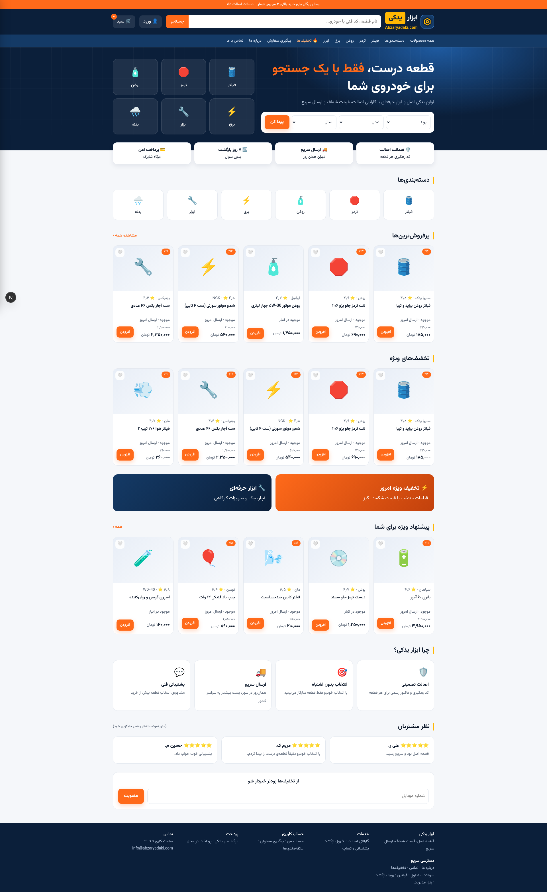
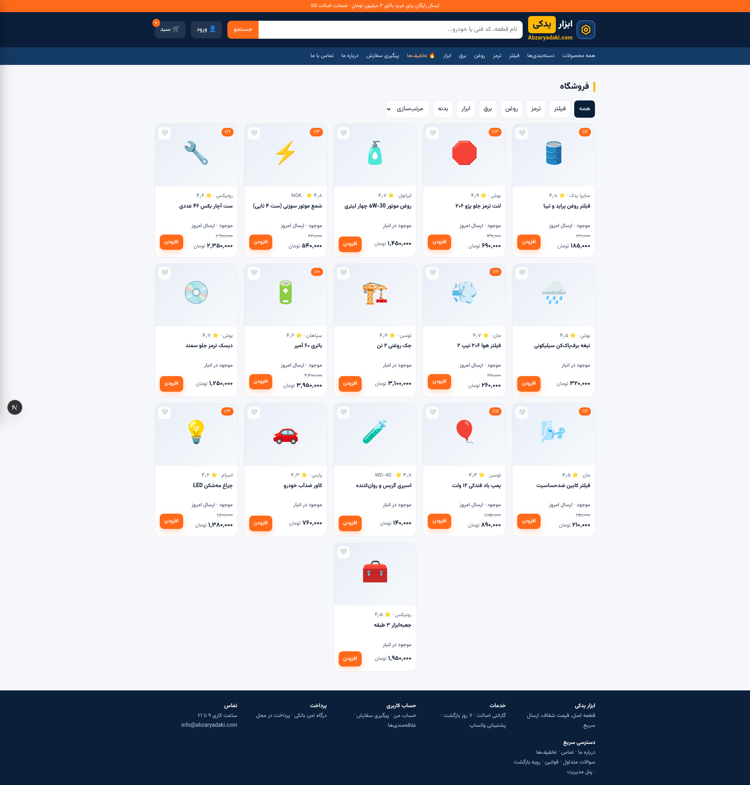
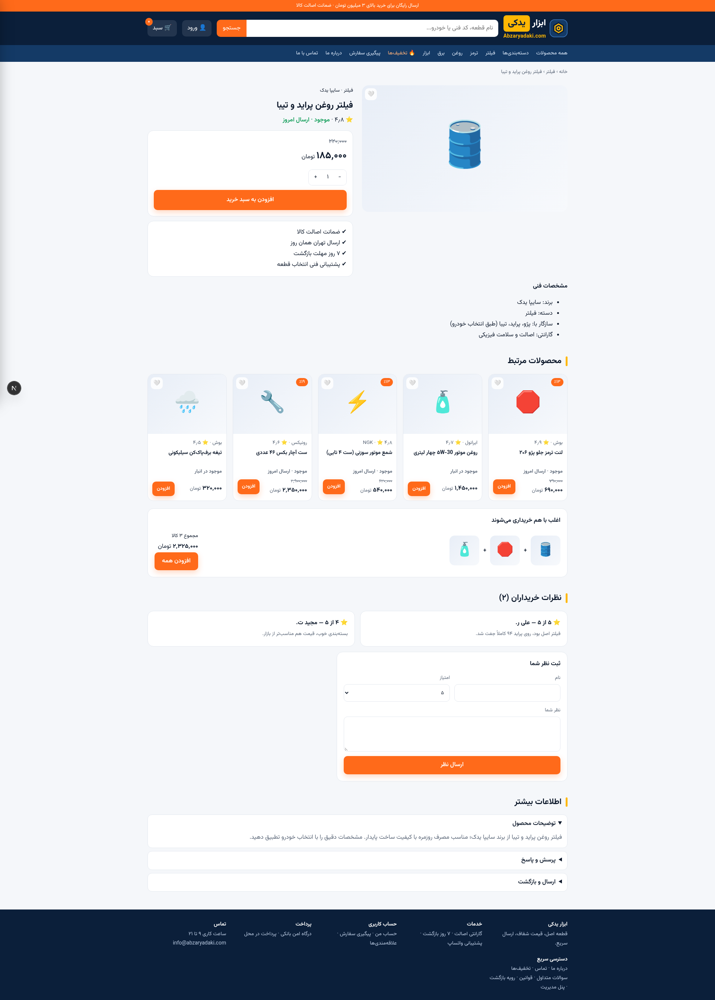
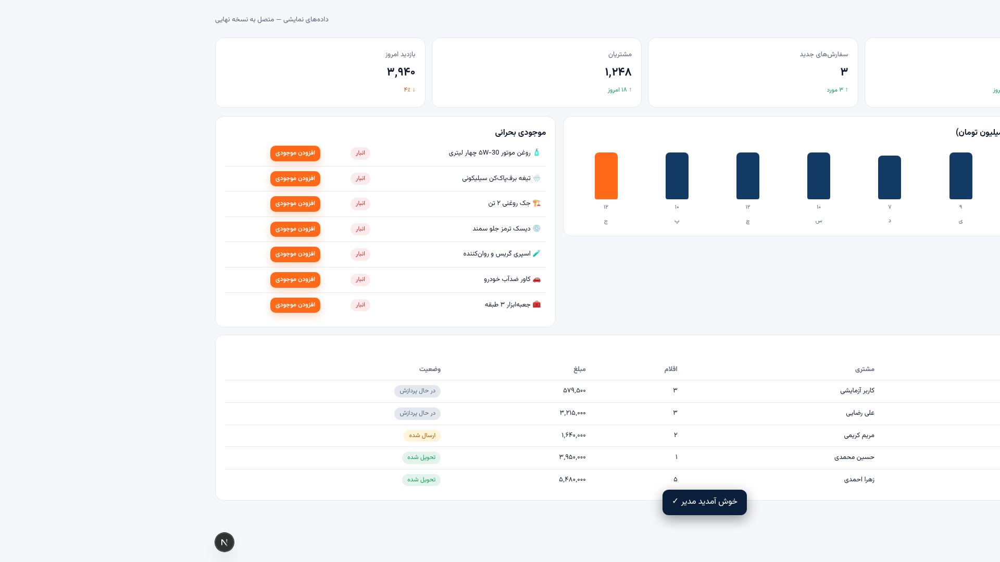
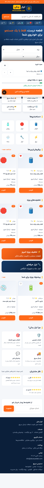
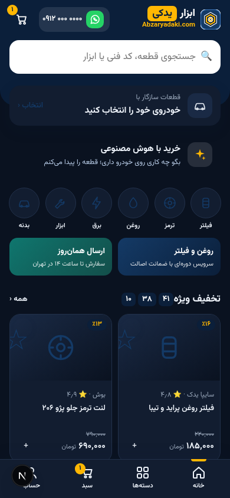

<div align="center">

[فارسی](README.md) · [English](README.en.md)


# ابزار یدکی | قالب فروشگاه اینترنتی فارسی

**فروشگاه اینترنتی کامل ابزار و لوازم یدکی خودرو — راست‌به‌چپ (RTL)، تمام‌فارسی، همراه با پنل مدیریت کامل و اپلیکیشن موبایل**

[](https://nextjs.org)
[](https://www.typescriptlang.org)
[](https://tailwindcss.com)
[](https://supabase.com)
[](https://github.com/pmndrs/zustand)
[](https://ui.shadcn.com)
[](https://vercel.com)
[](#)

**🌐 نمونهٔ زنده: [abzaryadaki.com](https://www.abzaryadaki.com)** — این پروژه یک فروشگاه واقعی و در حال کار است که می‌توانید به‌عنوان **قالب آماده برای ساخت فروشگاه اینترنتی جدید** از آن استفاده کنید.

*Persian (Farsi) RTL Auto Parts & Tools E-Commerce — Next.js 16 · TypeScript · Supabase · Vercel*

</div>

---

## 📸 نمای پروژه

| صفحه اصلی | فروشگاه |
|---|---|
|  |  |
| **جزئیات محصول** | **داشبورد پنل مدیریت** |
|  |  |
| **اپلیکیشن موبایل (خودکار روی گوشی)** | **حالت تاریب اپ موبایل** |
|  |  |

## 📖 این مخزن برای چیست؟

«ابزار یدکی» یک **فروشگاه اینترنتی واقعی و در حال کار** برای فروش ابزار دستی، برقی و لوازم یدکی خودرو است — و هم‌زمان یک **قالب (Template) کامل و فارسی برای ساخت فروشگاه اینترنتی جدید**:

- 🇮🇷 **تمام‌فارسی و راست‌به‌چپ از روز اول** — نه ترجمهٔ بعدی؛ فونت وزیرمتن، اعداد و قیمت فارسی (تومان)، تقویم و قالب‌بندی ایرانی
- 🧩 **پایهٔ فنی مدرن**: Next.js 16 (App Router)، TypeScript سخت‌گیرانه، Tailwind CSS 4، shadcn/ui، Zustand
- 🗄️ **بک‌اند آماده با Supabase**: PostgreSQL، احراز هویت پیامکی (OTP)، RLS، Realtime، ۴ migration آماده
- 🛠️ **پنل مدیریت ۱۰ بخشی** داخل همان سایت (بدون پروژهٔ جداگانه)
- 📱 **اپلیکیشن موبایل درون‌سایت**: روی نمایشگر تلفن یا مسیر `#app` به‌صورت خودکار اپ موبایل اختصاصی باز می‌شود
- 🚀 **دیپلوی یک‌کلیکی روی Vercel** — این سایت از همین مخزن روی abzaryadaki.com اجرا می‌شود

اگر می‌خواهید **فروشگاه اینترنتی خودتان را راه بیندازید** (هر محصولی: لوازم یدکی، مد و پوشاک، دیجیتال و...)، این مخزن را کپی کنید، برند و محصولات را عوض کنید و دامنه‌ی خود را وصل کنید.

## ✨ امکانات فروشگاه (Storefront)

- 🏠 **صفحهٔ اصلی**: بنرهای مدیریت‌پذیر، دسته‌بندی‌ها، پیشنهاد شگفت‌انگیز، پرفروش‌ها
- 🛍️ **فروشگاه و جست‌وجو**: جست‌وجوی زندهٔ **نرمال‌سازی‌شدهٔ فارسی** — «206» لاتین، «۲۰۶» فارسی، «پژو» با «ي/ك» عربی و «برف پاک کن» با فاصلهٔ معمولی همگی درست کار می‌کنند؛ فیلتر دسته/برند و مرتب‌سازی قیمت
- 📦 **جزئیات محصول**: مشخصات، امتیاز، نظرات، گالری، افزودن به سبد/علاقه‌مندی/لیست انتظار
- 🛒 **سبد خرید ماندگار**: بعد از بستن مرورگر می‌ماند (Zustand persist) + کشوی سبد + نوار خرید موبایل
- ⏳ **لیست انتظار دسته‌بندی‌شده**: «حذف‌شده از سبد» + «در حال بررسی» — قابل بازیابی بعد از رفرش
- ❤️ **علاقه‌مندی‌ها** با قلب روی هر کارت محصول
- 💳 **تسویه‌حساب دوسطحی** (آدرس و ارسال ← پرداخت) + **کد تخفیف** با اعتبارسنجی سمت سرور
- 🔐 **ورود/ثبت‌نام با OTP پیامکی** (سه‌مرحله‌ای) — Supabase Auth Phone
- 👤 **حساب من**: سفارش‌ها، آدرس‌ها، جزئیات هر سفارش
- 🔎 **پیگیری سفارش** با کد سفارش + شمارهٔ موبایل
- 🤖 **دستیار خرید هوشمند** (AI): پیشنهاد قطعه بر اساس خودروی مشتری — سمت سرور و با محدودیت نرخ (Rate Limit)
- 🛡️ **امنیت**: محدودیت نرخ روی APIهای عمومی، RLS کامل دیتابیس، قیمت‌گذاری و کوپن فقط سمت سرور
- 🌙 حالت تاریب · 📄 سوالات متداول، قوانین، رویهٔ بازگرداندن کالا، حریم خصوصی · صفحهٔ ۴۰۴ اختصاصی

## 🛠️ پنل مدیریت (`/#admin`)

گیت ورود امن + ۱۰ بخش کامل:

**داشبورد · محصولات (افزودن/ویرایش/حذف) · سفارش‌ها (جزئیات + تغییر وضعیت) · مشتریان · نظرات (صف تأیید) · کوپن‌ها · بنرها · پیام‌های تماس با ما · گزارش فروش · تنظیمات فروشگاه**

- در حالت اتصال به Supabase: دادهٔ **واقعی** با CRUD، Realtime و RLS
- بدون دیتابیس (دمو): پنل با دادهٔ نمایشی فارسی کار می‌کند — ورود نمایشی `admin` / `admin123` **فقط در همین حالت دمو و بدون هیچ اتصال واقعی**

## 🧱 فناوری‌ها

| لایه | فناوری |
|------|--------|
| فریم‌ورک | [Next.js 16](https://nextjs.org) — App Router + Turbopack |
| زبان | TypeScript (strict) |
| استایل | Tailwind CSS 4 + توکن‌های طراحی سفارشی |
| کامپوننت | shadcn/ui |
| بک‌اند | [Supabase](https://supabase.com) — PostgreSQL، Auth (OTP پیامکی)، Realtime، RLS |
| مدیریت وضعیت | Zustand + persist |
| هوش مصنوعی | دستیار خرید سمت سرور (Route Handler) |
| فونت | [وزیرمتن](https://github.com/rastikerdar/vazirmatn) (Variable) |
| مسیریابی | Hash Router سفارشی همسان با طراحی |
| اجرا و دیپلوی | Bun · Vercel |

## 🚀 راه‌اندازی سریع (فروشگاه خودتان را بسازید)

```bash
# ۱) کپی مخزن و نصب
git clone https://github.com/miterhdot/Abzar-Yadaki.git my-shop
cd my-shop
bun install          # یا: npm install

# ۲) اجرای محیط توسعه (بدون دیتابیس هم کار می‌کند — حالت دمو)
bun run dev          # http://localhost:3000

# ۳) بررسی کد و ساخت نسخهٔ تولید
bun run lint
bun run build
```

### اتصال به Supabase (اختیاری — برای دادهٔ واقعی)

1. در [supabase.com](https://supabase.com) پروژه بسازید
2. فایل‌های `supabase/migrations/0001..0004.sql` را به‌ترتیب در SQL Editor اجرا کنید (جدول‌ها + seed + تابع سفارش + بک‌اند ادمین، همراه RLS)
3. متغیرهای محیطی را تنظیم کنید (روی Vercel هم همین دو متغیر):

```bash
NEXT_PUBLIC_SUPABASE_URL=...
NEXT_PUBLIC_SUPABASE_ANON_KEY=...
```

4. برای OTP پیامکی، سرویس Phone Auth ساپابیس را فعال کنید
5. پنل مدیریت را با حسابی که در جدول پروفایل‌ها نقش `admin` دارد باز کنید

### چک‌لیست سفارشی‌سازی برای فروشگاه جدید

- [ ] نام، لوگو و رنگ‌ها (توکن‌های طراحی در `globals.css` و `mobile/app.css`)
- [ ] دسته‌بندی‌ها و محصولات (از پنل ادمین یا فایل seed)
- [ ] برندها، بنرهای صفحهٔ اصلی و متن‌های صفحات ثابت
- [ ] اتصال درگاه پرداخت بانکی (الگوی آماده در `docs/PROPOSALS.md`)
- [ ] دامنه و دیپلوی روی Vercel

## 📁 ساختار پروژه

```
├── src/
│   ├── app/                  # ورودی Next.js (layout + globals.css + api/)
│   ├── components/site/      # پوستهٔ سایت (هدر/فوتر/سبد/نوار موبایل)
│   │   ├── views/            # صفحات فروشگاه (خانه، فروشگاه، محصول، تسویه، ...)
│   │   └── admin/            # پنل مدیریت (گیت ورود + ۱۰ تب)
│   ├── mobile/               # اپلیکیشن موبایل درون‌سایت (#app)
│   ├── lib/                  # وضعیت (Zustand)، روتر، فرمت فارسی، نرمال‌سازی جستجو، rate-limit
│   └── data/                 # دادهٔ نمایشی فروشگاه (فارسی)
├── supabase/migrations/      # ۴ migration: شِما + seed + سفارش + بک‌اند ادمین (با RLS)
├── docs/                     # مستندات رسمی پروژه
└── public/                   # لوگو، فونت وزیرمتن
```

## 📚 مستندات

| سند | محتوا |
|-----|-------|
| [قوانین عمومی](docs/RULES.md) | بندهای الزام‌آور پروژه |
| [دفتر دستورات](docs/COMMANDS.md) | ثبت کامل دستورات مدیر + اقدامات |
| [سیم‌کشی/معماری](docs/ARCHITECTURE.md) | لایه‌ها، مسیرها، استورها |
| [پیشنهادها](docs/PROPOSALS.md) | برنامهٔ حرفه‌ای‌سازی و امکانات آینده |
| [نقشه راه](docs/ROADMAP.md) | فازهای W1..W5 + نسخهٔ موبایل مستقل |
| [دفتر خروجی‌ها](docs/RELEASES.md) | نسخه‌بندی و سیاست کلید |
| [گزارش تغییرات](docs/CHANGELOG.md) | تاریخچهٔ کامل نسخه‌ها |

## 🗺️ وضعیت توسعه

- ✅ نسخهٔ وب‌سایت: همهٔ صفحات مشتری + پنل مدیریت کامل + اپ موبایل درون‌سایت
- ✅ امنیت و کیفیت: جست‌وجوی فارسی نرمال‌شده، محدودیت نرخ، وابستگی‌های به‌روز (صفر آسیب‌پذیری بحرانی)
- 🔜 درگاه پرداخت بانکی، فیلترهای پیشرفته و جست‌وجوی قطعه بر اساس خودرو (به `docs/PROPOSALS.md` مراجعه کنید)

## 🎨 اعتبار طراحی

طراحی رابط کاربری و تجربهٔ کاربری این فروشگاه بر اساس فایل‌های طراحی ارائه‌شدهٔ
**[مهرداد | Mehrdad.ir](https://Mehrdad.ir)** پیاده‌سازی شده است.

---

<div align="center">

**[abzaryadaki.com](https://www.abzaryadaki.com)** — ابزار و لوازم یدکی خودرو

© ۱۴۰۵ ابزار یدکی — تمامی حقوق محفوظ است · طراحی: [Mehrdad.ir](https://Mehrdad.ir)

</div>
